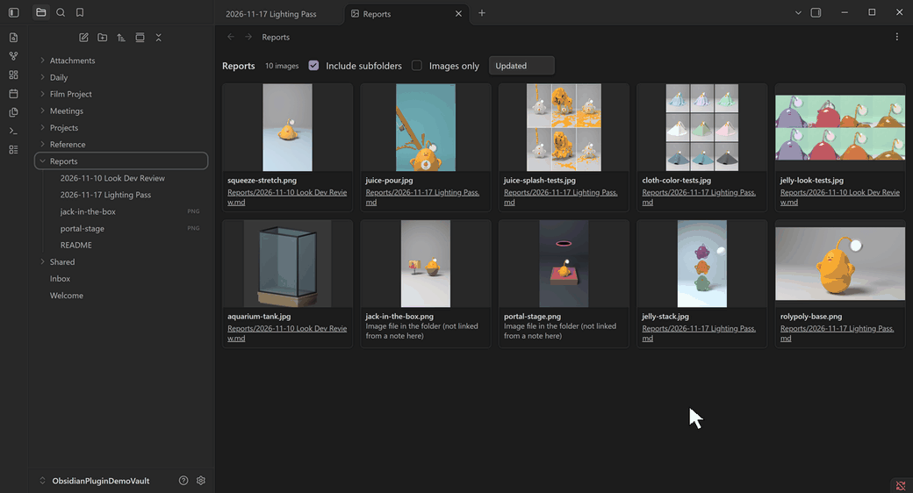
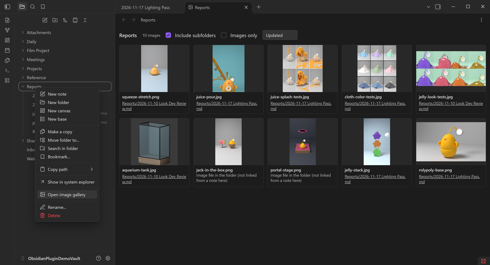
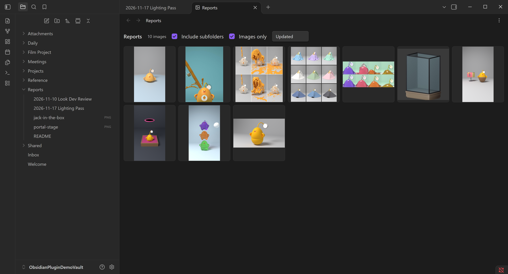
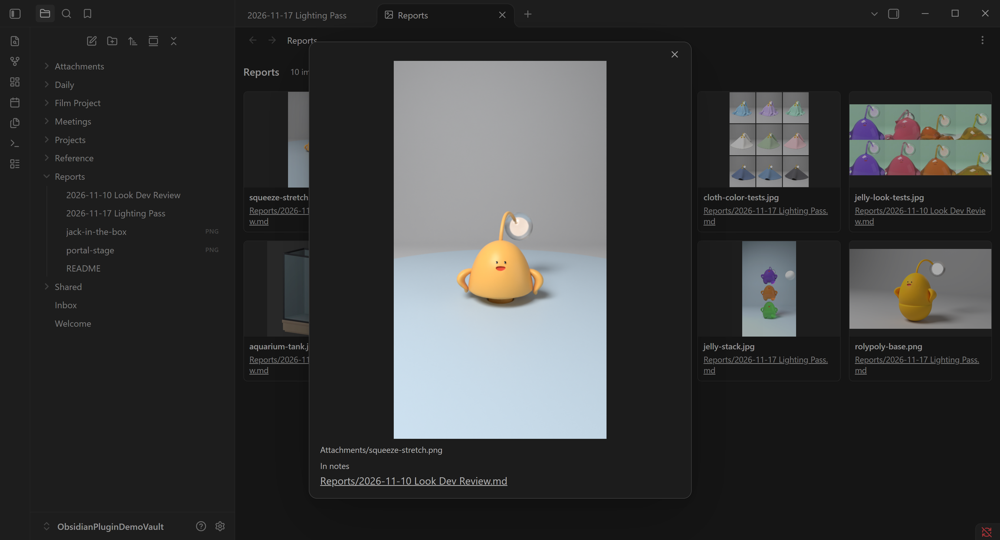

# Folder Image Gallery

**Unagi Tech Inc.（株式会社うなぎテック）** · MIT License

[English](README.md) | 日本語

フォルダの中の画像を、ギャラリーとして一覧で表示する Obsidian のプラグインです。

フォルダに置いてある画像ファイルに加えて、そのフォルダのノートに埋め込んだ画像やリンクした画像も表示します。画像ファイルが添付ファイル用のフォルダなど別の場所にあっても表示されます。重複ファイルは、1枚だけ表示されます。

## できること

- **フォルダから開く**：ファイルエクスプローラーでフォルダを右クリックし、「画像ギャラリーを開く」を選ぶと、新しいタブにギャラリーが開きます
- **コマンドから開く**：コマンド「このフォルダの画像ギャラリーを開く」を使います。ファイルエクスプローラーで選んでいるフォルダか、開いているノートのあるフォルダが対象になります
- **ノートの画像もまとめて表示**：フォルダの中の画像ファイルと、ノートに埋め込んだりリンクしたりした画像を、まとめて表示します
- **サブフォルダの切り替え**：サブフォルダの中まで含めるかどうかを、ギャラリーのタブで切り替えられます
- **画像のみ**：サムネイル下のファイル名とノートへのリンクを隠し、画像だけの一覧にします。ギャラリーのタブで切り替えられます
- **拡大とノートへの移動**：サムネイルをクリックすると拡大します。画像ごとに、その画像を使っているノートが表示され、クリックするとそのノートが開きます
- **並べ替え**：更新日時、名前、ノート順で並べ替えられます
- **日本語と英語に対応**：Obsidian の言語の設定に合わせて切り替わります

## スクリーンショット

フォルダを右クリックし、「画像ギャラリーを開く」を選びます。

「画像のみ」をオンにすると、ファイル名とノートへのリンクが隠れ、画像だけの一覧になります。

サムネイルをクリックすると拡大します。下に、その画像を使っているノートが表示されます。

## 設定

| 設定 | 初期値 | 内容 |
|---|---|---|
| サブフォルダを含む | オン | ギャラリーを開いたときに、選んだフォルダの中にあるフォルダの画像も含めます |
| 画像のみ | オフ | ギャラリーを開いたとき、各サムネイル下のファイル名とノートへのリンクを隠します。ギャラリーのタブでも変えられます |
| 並び順 | 更新日時 | ギャラリーを開いたときの並び順です。ギャラリーのタブでも変えられます |

## インストール

**コミュニティプラグインから**

1. 設定 → コミュニティプラグイン →「閲覧」を開く
2. 「Folder Image Gallery」を探してインストールし、有効化する

**手動でインストールする**

1. [最新のリリース](https://github.com/UnagiTechLab/folder-image-gallery/releases/latest)から `main.js`、`manifest.json`、`styles.css` をダウンロードする
2. `<Vault>/.obsidian/plugins/folder-image-gallery/` に置く
3. 設定 → コミュニティプラグインで、「インストール済みプラグイン」の横にある再読み込みのボタンを押し、「Folder Image Gallery」をオンにする

## 使うときの注意

- 読み込むノートは 800 件まで、表示する画像は 600 枚までです
- 1.5 MB を超えるノートは、本文の中の画像リンクを読み取りません。Obsidian が持っているリンクの情報は使います
- スマホでは、コマンドから開いてください。ファイルエクスプローラーのメニューは、アプリによっては使えません

## プライバシー

このプラグインはネットワークに接続せず、データも集めません。対象となるのは、Vault の中のノートと画像だけです。

## ライセンス

[MIT](LICENSE) — Copyright (c) 2026 Unagi Tech Inc.

改変したり再配布したりするときは、コピーライトの表記を残してください。

## 免責

このプラグインは、[ライセンス](LICENSE)にあるとおり、現状のままで提供します。Vault のバックアップを取っておいてください。使ったことで起きたデータの消失やそのほかの損害について、Unagi Tech Inc. は責任を負いません。

このプラグインは独自に開発したもので、Obsidian（Dynalist Inc.）が作ったり、認めたり、サポートしたりしているものではありません。

## 応援

チップは任意です（Ko-fi）。無料のツールを出し続け、直し続けるための支えになります。

## リンク

- Lab：[UnagiTechLab](https://github.com/UnagiTechLab)
- 会社：[unagi.tech](https://www.unagi.tech)
- 不具合の報告・要望：[Issues](https://github.com/UnagiTechLab/folder-image-gallery/issues)
